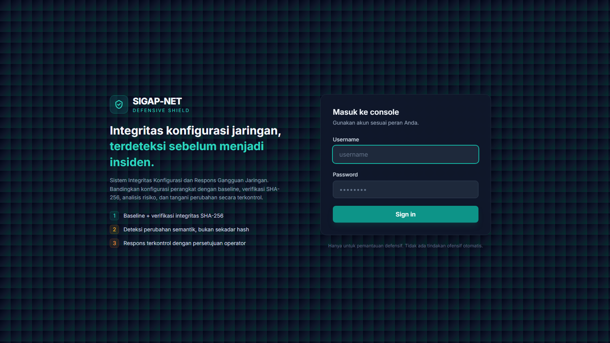
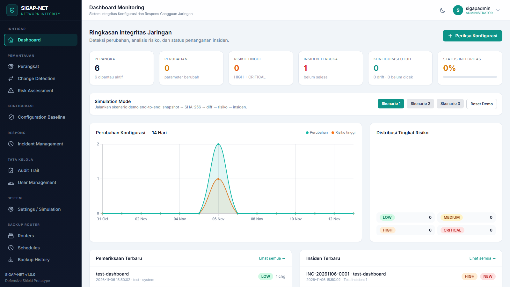
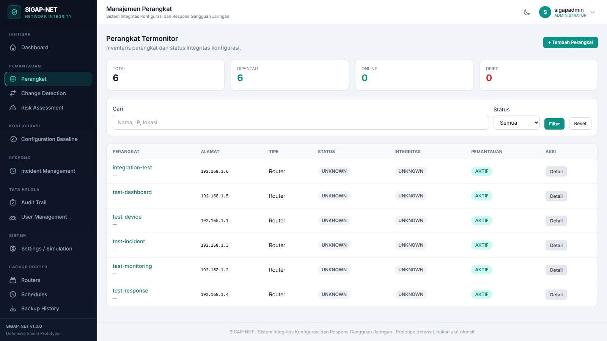
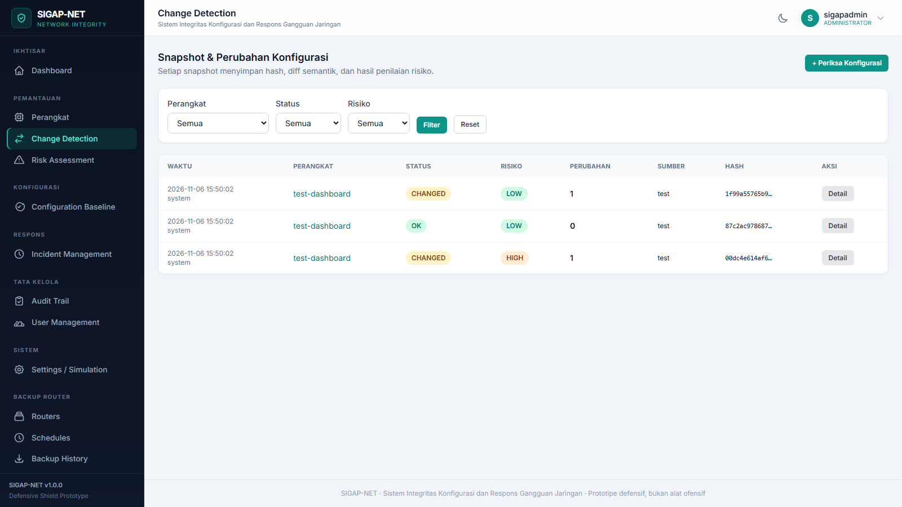
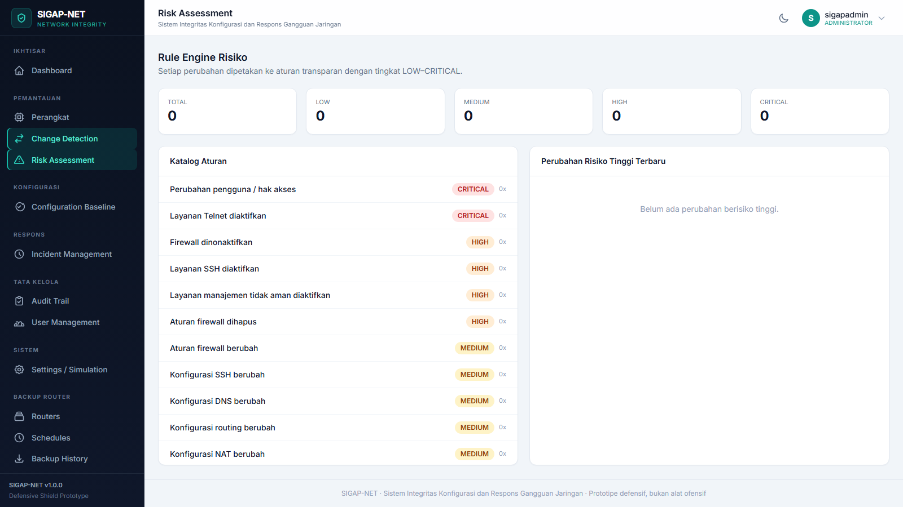
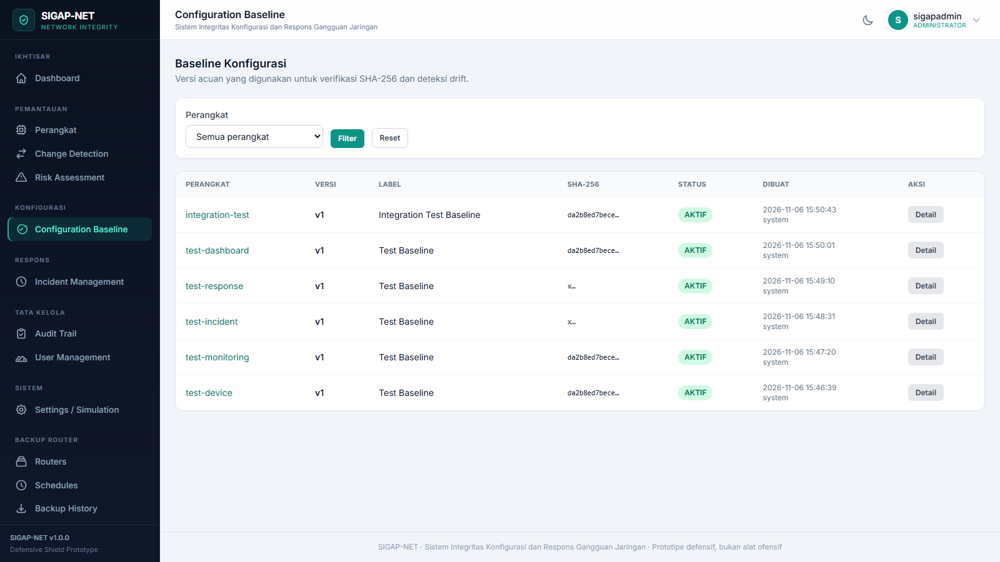
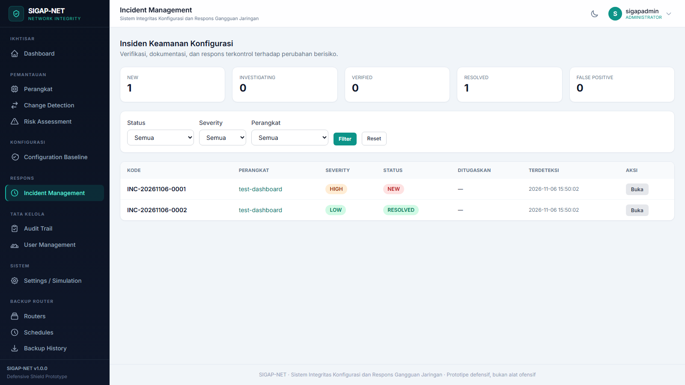
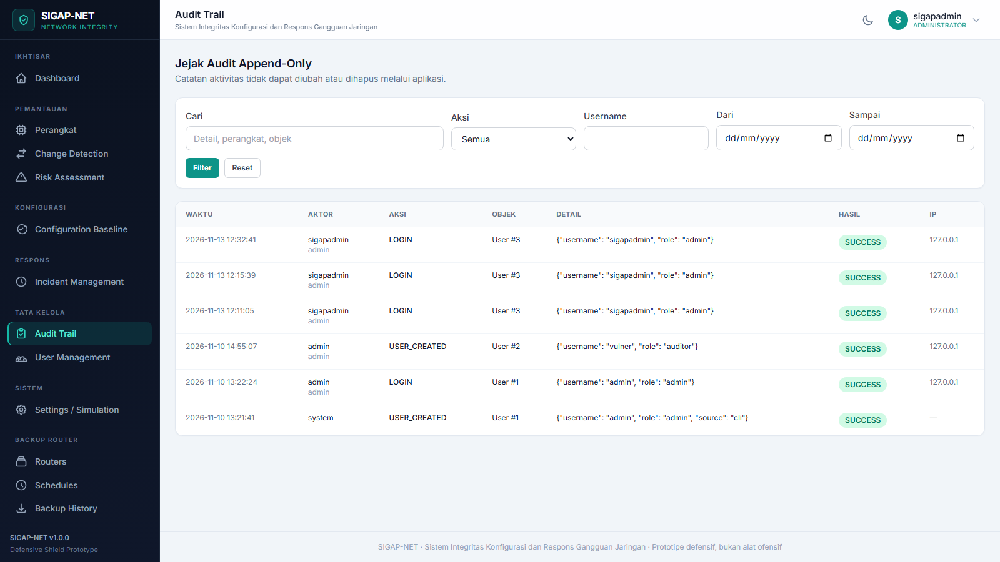
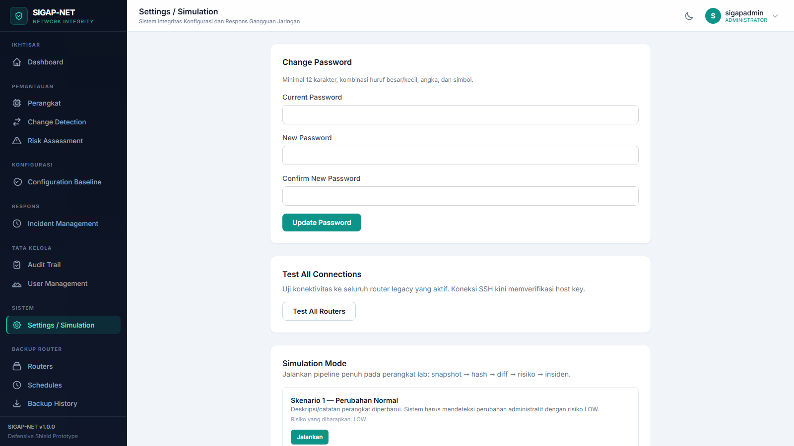
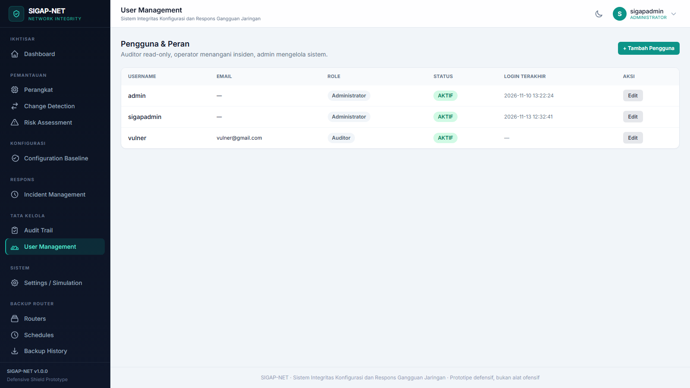

# MikroTik Backup Dashboard

Aplikasi web untuk manajemen backup konfigurasi router MikroTik dengan database MySQL, penjadwalan, dan antarmuka pengguna berbasis Flask.

Fitur utama:
- Simpan konfigurasi backup router MikroTik ke file
- Kelola router, jadwal backup, dan aktivitas backup
- SIGAP-NET: baseline konfigurasi, pemeriksaan integritas SHA-256, deteksi drift,
  analisis risiko, insiden, audit trail, persetujuan respons, dan simulasi aman
- RBAC (admin/operator/auditor), CSRF, password policy, dan login throttling
- Restore perangkat nyata dinonaktifkan secara default (simulasi tetap tersedia)
- Menggunakan Flask, SQLAlchemy, Flask-Migrate, dan Gunicorn

## Persyaratan

- Python 3.12 atau lebih baru untuk pengembangan lokal (dikembangkan dengan Python 3.13)
- Tidak perlu Docker atau MySQL untuk pemakaian lokal — SQLite dipakai otomatis
  di `data/sigapnet.db`
- Docker dan Docker Compose tersedia jika ingin mode container (lihat bagian
  Docker Compose)

## Screenshot Apps

| | |
|---|---|
|  |  |
|  |  |
|  |  |
|  |  |
|  |  |

## Instalasi dan pengembangan lokal

Langkah berikut sesuai dengan cara aplikasi ini dijalankan di mesin
pengembangan (Windows, Python 3.13, tanpa virtual environment, SQLite).

1. Pasang dependensi:
   ```
   pip install -r requirements.txt
   ```

2. Inisialisasi database (sekali saja — membuat `data/sigapnet.db`):
   ```
   python -m flask --app app init-db
   ```

3. Buat administrator. Hanya username yang menjadi argumen; password diminta
   tersembunyi saat perintah dijalankan (minimal 12 karakter, wajib huruf
   besar + kecil + angka + simbol):
   ```
   python -m flask --app app create-admin sigapadmin
   ```

   Password tidak bisa dipipe dari script di Windows — ketik langsung di konsol.
   Tidak ada akun atau password default yang dibuat otomatis.

4. Jalankan aplikasi:
   ```
   python -m flask --app app run --debug
   ```

5. Buka browser ke `http://localhost:5000` dan login dengan akun yang dibuat
   pada langkah 3.

Catatan:

- Tidak ada file `.env` yang dibutuhkan untuk pemakaian lokal; `DATABASE_URL`
  tidak diset sehingga SQLite `data/sigapnet.db` dipakai.
- Mode simulasi diaktifkan per perangkat lewat UI (adapter `simulation`),
  bukan lewat variabel lingkungan `SIMULATION`.

## Pengujian

``` 
pip install -r requirements-dev.txt
python -m pytest -q
```

Tes mencakup parser konfigurasi, hash/diff semantik, tiga skenario simulasi,
pembuatan insiden, audit append-only, RBAC, CSRF, login throttling, render semua
template, CLI inisialisasi, restore simulasi/rollback, dan pemblokiran restore
perangkat nyata.

## Docker Compose (development / production ringan)

1. Salin contoh environment dan sesuaikan nilai:

   ```
   cp .env-example .env
   ```

2. Jalankan Compose:

   ```
   docker compose up -d --build
   ```

3. Akses aplikasi:

   ```
   http://localhost:5000

   Atau

   http://localhost:8500
   ```

Pengaturan ini otomatis memetakan direktori `backups/` dan `logs/` dari host ke container.

ganti permission jika direktori backups dan logs menjadi user root :

```
sudo mkdir -p logs backups
sudo chown -R 1000:1000 logs backups
sudo chmod -R u+rwX logs backups
```

## Environment variables

- `DATABASE_URL`: URL koneksi SQLAlchemy (MySQL, atau SQLite untuk lokal)
- `SECRET_KEY`: kunci rahasia Flask untuk sesi dan CSRF
- `SESSION_COOKIE_SECURE`: `true` jika HTTPS digunakan, `false` untuk HTTP lokal
- `FLASK_ENV`: `production` atau `development`
- `ADMIN_USERNAME` / `ADMIN_PASSWORD`: opsional untuk `flask ensure-admin`;
  password kosong berarti tidak ada akun admin otomatis
- `SIGAP_SEED_DEMO_USERS`: dicadangkan; akun demo hanya dibuat lewat perintah eksplisit `flask seed-demo-users`
- `SIGAP_SHOW_DEMO_ACCOUNTS`: `true` hanya untuk menampilkan kredensial demo di halaman login
- `SIGAP_ALLOW_REAL_RESTORE`: dicadangkan; restore perangkat nyata belum diimplementasikan dan tetap diblokir
- `LOGIN_MAX_ATTEMPTS` / `LOGIN_WINDOW_SECONDS`: batas percobaan login per jendela waktu
- `SSH_KNOWN_HOSTS_FILE`: path known_hosts untuk verifikasi host key SSH
- `MYSQL_DATABASE`, `MYSQL_USER`, `MYSQL_PASSWORD`, `MYSQL_ROOT_PASSWORD`: konfigurasi MySQL untuk Docker

## Service systemd (production)

1. Copy file service ke `/etc/systemd/system/mikrobackup.service`.
2. Siapkan file environment pada `/etc/mikrotik-backup.env` dengan nilai:
   ```
   DATABASE_URL=... 
   SECRET_KEY=...
   SESSION_COOKIE_SECURE=true
   FLASK_ENV=production
   ADMIN_USERNAME=admin
   # Contoh; wajib diganti dengan password unik yang kuat
   ADMIN_PASSWORD=ContohPasswordKuat!2026
   ```
3. Pastikan aplikasi di-deploy ke `/opt/mikrotik-backup` dan virtual environment berada di `/opt/mikrotik-backup/.venv`.
4. Reload systemd dan aktifkan service:
   ```
   sudo systemctl daemon-reload
   sudo systemctl enable mikrobackup.service
   sudo systemctl start mikrobackup.service
   ```

## Catatan produksi

- Jangan simpan file `.env` berisi password ke repositori.
- Pastikan `SECRET_KEY` adalah nilai acak panjang.
- Gunakan HTTPS di depan Gunicorn jika menjalankan di internet publik.
- Biarkan `SIGAP_ALLOW_REAL_RESTORE=false`; restore perangkat nyata belum diaktifkan.
- Konfigurasikan `SSH_KNOWN_HOSTS_FILE` agar host key MikroTik diverifikasi.
- Volume `backups/` dan `logs/` harus bisa ditulis oleh container atau user service.

## Struktur repositori penting

- `app.py`: aplikasi Flask utama
- `config.py`: konfigurasi Flask dan SQLAlchemy
- `db.py`: model database
- `docker-compose.yml`: setup container
- `Dockerfile`: definisi image aplikasi
- `entrypoint.sh`: startup container, migrasi, dan Gunicorn
- `mikrobackup.service`: contoh unit systemd
- `requirements.txt`: dependensi Python
- `migrations/`: skrip Alembic versioned
- `backups/`, `logs/`: direktori data runtime
